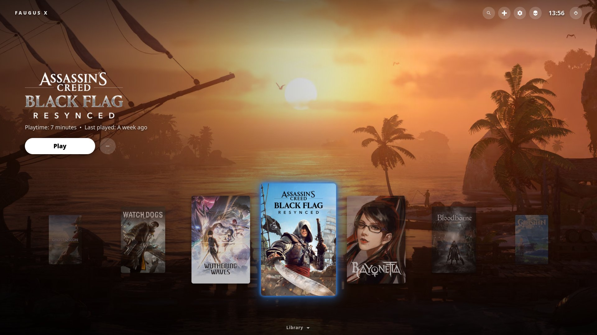
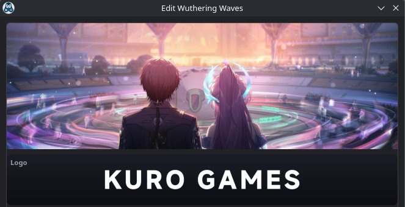
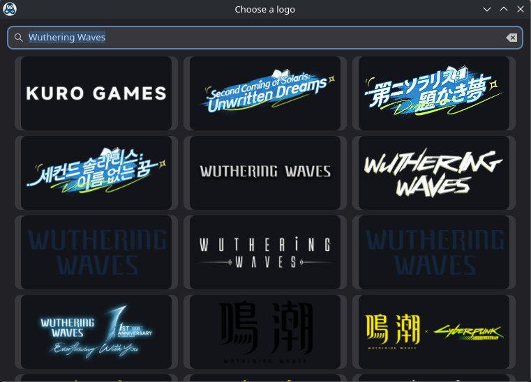
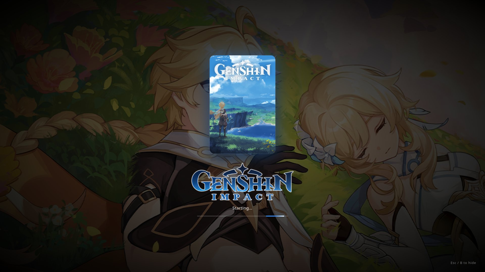
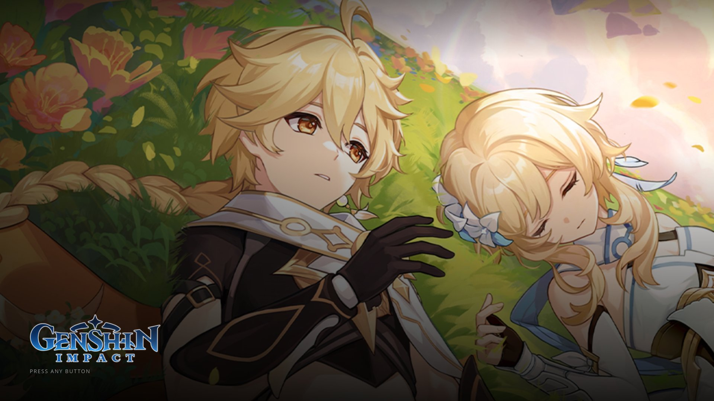
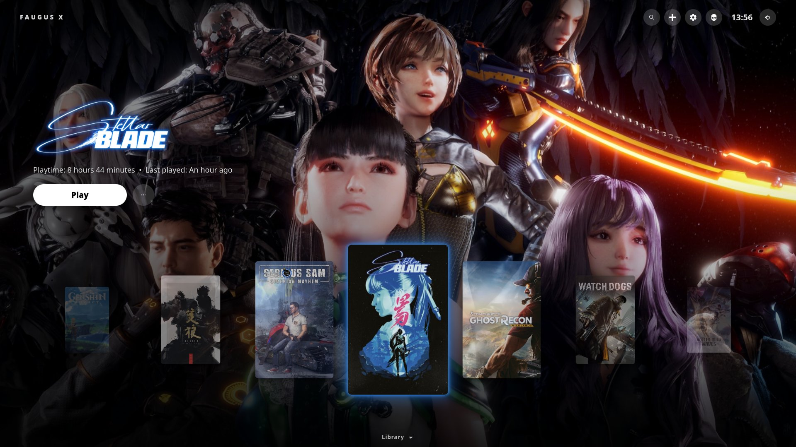
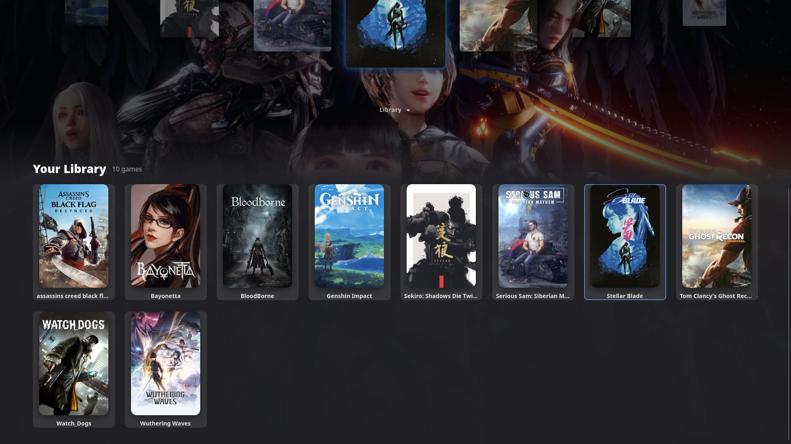

# Faugus X

A console-style fork of [Faugus Launcher](https://github.com/Faugus/faugus-launcher), the simple and lightweight app for running Windows games on Linux with [UMU-Launcher](https://github.com/Open-Wine-Components/umu-launcher).

Faugus X keeps everything Faugus does and adds **Showcase**, a full-screen interface inspired by game consoles and Steam's Big Picture: big moving game art, real game logos, a console-style launch screen, and an idle attract mode.



> **Unofficial fork.** Faugus X is not made or endorsed by the Faugus developer. Please report Faugus X bugs here, not to the Faugus project. For everything that isn't Showcase-specific (installation, Proton, prefixes, Steam shortcuts…) see the original [Faugus README](README.faugus.md).

## What Faugus X adds

### Showcase interface
A new **Showcase** interface mode, next to Faugus' List, Grid, Covers and Carrousel modes.

- **Full-screen by default.** Toggle with the button in the top-right corner or **F11**.
- **Hero area** for the selected game: its logo, playtime, last played, and big **Play** / **Stop** and **⋯** (game menu) buttons.
- **Carousel** of covers along the bottom, as in Faugus' Carrousel mode.
- **Top bar** with search (**Ctrl+F**), add game, settings, kill and fullscreen buttons, plus a clock. The bottom bar is hidden.
- **Your Library**: scroll down for a grid of every game. Click to select, double-click to play, right-click for the game menu.

### Animated full-screen backdrop
- The selected game's banner fills the whole screen and slowly drifts and zooms.
- Switching games crossfades to the new banner.
- Games without a banner use their cover, blurred.
- **HD banners:** Faugus stores banners at 1920×620, which looks soft when stretched to a full screen. Faugus X downloads the full-resolution (3840×1240) copy of *the same banner* from SteamGridDB, matched by comparing images, so your chosen banner is respected.

### Game logos
- Each game shows its **transparent logo** from SteamGridDB instead of plain text, in the hero, on the launch screen and in attract mode.
- **Change logo** in the game's edit window: a new **Logo** slot under the banner opens a searchable SteamGridDB logo picker. Right-click it to load a logo from a file, use the text title instead, or go back to automatic.

| Logo slot in the edit window | Logo picker |
|---|---|
|  |  |

### Console-style launch screen
When you start a game, a full-screen launch screen shows the game's art, cover and logo with live status from the runner (Proton/UMU setup, downloads…). It stays up until the game window actually appears, instead of dropping back to the launcher in between. Press **Esc** or **B** on a controller to hide it.



### Attract mode
After 45 seconds without input on the home screen, the interface fades away and Faugus X cycles through your games' banners with their logos and **PRESS ANY BUTTON**, like a console. Any mouse, keyboard or controller input wakes it; that first press only wakes the screen. It never starts while a menu, dialog, search or the launch screen is open.



### Download missing artwork
**Settings → Interface**, under the SteamGridDB API key: **Download missing artwork** goes through every game and fills the gaps: banners, HD banners and logos. It never replaces artwork you already have or picked yourself.

### Open when a controller connects
**Settings → Miscellaneous → Open when a controller connects**: plug in or connect a controller, or press its **PS / Home** button after it was off or idle for a minute, and Faugus X opens (or comes to the front), like a console. Controllers with a USB wireless dongle only work with the Home button, since the dongle stays connected. It also works right after login, without Faugus X running. It never opens while a game started from Faugus is running, so a controller that reconnects mid-game won't interrupt you. Steam's virtual controller is ignored.

### Smooth on modest hardware
Artwork is decoded in the background, the backdrop is drawn without per-frame restyling, and heavy work waits until carousel slides finish. Tested at 60 fps on Intel UHD 630 integrated graphics.

## Screenshots

<details>
<summary><b>More screenshots</b></summary>
<br>

**Home**




**Your Library**




</details>

## Getting started

Faugus X installs **alongside Faugus**. Both can be installed and even open at the same time. They share your games, covers, banners, prefixes and playtime, so anything you add in one shows up in the other. Faugus X keeps its own settings in `~/.config/faugus-x/`, starting from a copy of your Faugus settings.

### Install (any distribution)
Install the dependencies (the same as Faugus):
```
python-gobject python-requests python-pillow python-vdf python-psutil icoextract gtk4 libadwaita libmanette
```
Then:
```
git clone -b faugus-x https://github.com/DragonEmperor9480/faugus-X.git
cd faugus-X
./packaging/faugus-x/install.sh
```
This installs Faugus X for your user (in `~/.local`) and adds **Faugus X** to your app menu. Use `sudo ./packaging/faugus-x/install.sh --system` to install it for all users instead.

To update, `git pull` and run the install script again. To remove it, run `./packaging/faugus-x/install.sh --uninstall`. Your games and settings are kept.

### Arch-based distributions
Install Faugus X as a package (`faugus-x-git`), so pacman tracks it and installs the dependencies:
```
git clone -b faugus-x https://github.com/DragonEmperor9480/faugus-X.git
cd faugus-X/packaging/faugus-x
makepkg -si
```
To update, run `makepkg -si` there again. To remove it, run `sudo pacman -R faugus-x-git`.

### Run from source (development)
```
git clone -b faugus-x https://github.com/DragonEmperor9480/faugus-X.git
cd faugus-X
python3 -m faugus.launcher
```

### First start
- **A SteamGridDB API key is required.** Faugus X relies on SteamGridDB for banners, HD backgrounds and logos. On first start it asks for your free [API key](https://www.steamgriddb.com/profile/preferences/api) and checks it with SteamGridDB before continuing. It asks again if SteamGridDB is turned off in Settings.
- **Showcase is the default interface.** If you used Faugus before, Faugus X switches you to Showcase once on its first start. You can still pick List, Grid, Covers or Carrousel in **Settings → Interface → Interface Mode**.
- **Gamepad navigation is on by default**, so you can use Faugus X with a controller right away. Turn it off in **Settings → Miscellaneous → Gamepad navigation**.

## Controls

| Action | Keyboard / mouse | Controller |
|---|---|---|
| Browse games | ← → ↑ ↓ or W A S D / scroll | D-pad / left stick |
| Play | Enter / Play button | Cross / A |
| Game menu | ⋯ button / right-click | Triangle / Y |
| Search | Ctrl+F (Esc to close) | |
| Fullscreen | F11 | |
| Hide launch screen | Esc | Circle / B |
| Wake from attract mode | any key / mouse move | any button |

Other controller buttons work as in Faugus (see the [gamepad mapping](README.faugus.md#gamepad-mapping)).

## Files

Faugus X stores its extra artwork next to Faugus' own:

| What | Where |
|---|---|
| Logos | `~/.local/share/faugus-launcher/logos/` |
| HD banners | `~/.local/share/faugus-launcher/banners-hd/` |

Delete a game's file there to have it downloaded again.

The idle time before attract mode can be changed with the `FAUGUS_X_IDLE_SECONDS` environment variable (default 45).

## Staying in sync with Faugus

Faugus X is built to follow upstream Faugus easily. Almost all of it lives in its own files:

```
faugus/showcase.py         Showcase interface
faugus/launch_screen.py    launch screen
faugus/backdrop.py         animated backdrop
faugus/hd_banners.py       HD banner matching
faugus/logos.py            logo downloads and cache
faugus/logo_editor.py      Logo slot and picker in the edit window
faugus/artwork_refresh.py  "Download missing artwork"
faugus/xbridge.py          launch status from the runner to the launch screen
faugus/x_setup.py          first-run defaults and the SteamGridDB requirement
faugus/controller_watch.py open Faugus X when a controller connects
packaging/faugus-x/        installer and PKGBUILD
```

Faugus' own files only have small, commented changes: the Showcase mode and two startup calls in `launcher.py`, a few lines in `runner.py` for the launch status, and the separate app ID and settings file in `path_manager.py` (plus one-line ID fixes in `tray_only.py`, `shortcut.py` and the autostart entry, and a `--controller-watch` line in the `faugus-launcher` script).

## Credits and license

- [Faugus Launcher](https://github.com/Faugus/faugus-launcher) by Faugus: the launcher Faugus X is built on. If you like it, consider supporting the original project: [Ko-fi](https://ko-fi.com/K3K210EMDU) · [PayPal](https://www.paypal.com/donate/?business=57PP9DVD3VWAN&no_recurring=0&currency_code=USD).
- Game artwork and logos come from [SteamGridDB](https://www.steamgriddb.com/), downloaded with each user's own API key.
- Released under the [MIT License](LICENSE), like Faugus.
